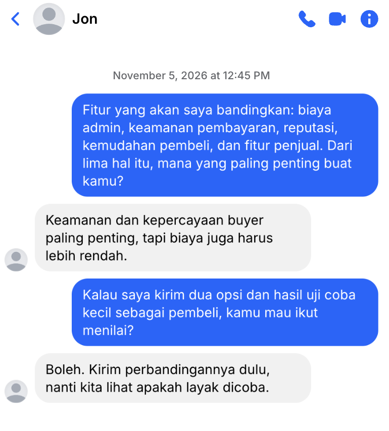
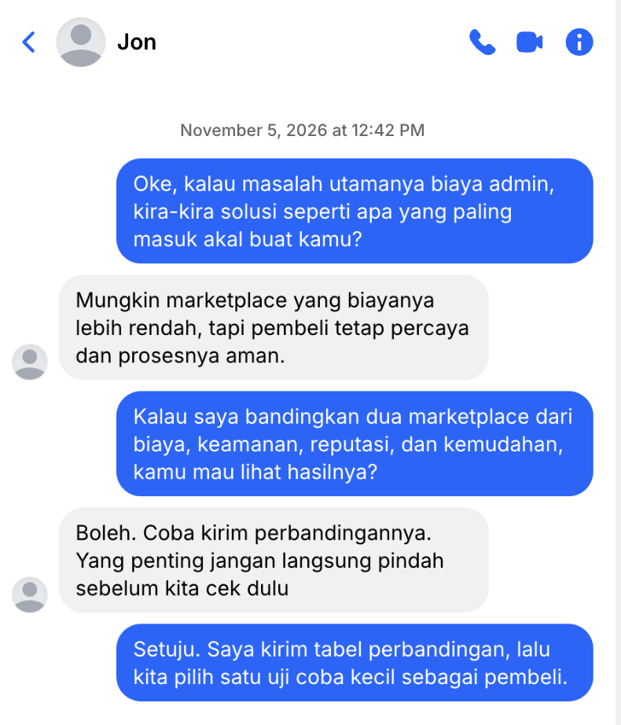

## Kompetensi target

Memilih target person yang tepat dan membuat issue diakui relevan melalui evidence.

## Evidence wajib

- Target map dan alasan memilih satu target.
- Problem/opportunity pitch serta evidence.
- Response, state sesudah pitch, dan adaptation.

## Konteks performance

**Tanggal dan setting:** Discovery interview berlangsung pada 22 September 2026 selama sekitar 30 menit melalui percakapan daring dengan Jon, nama samaran untuk penjual diecast. Follow-up attention pitch dilakukan pada Rabu, 4 November 2026 melalui Chat Facebook/Messenger.

**Objective dan initial state:** Objective follow-up saya adalah memastikan apakah biaya admin marketplace memang merupakan masalah utama bagi Jon, sebelum membahas solusi. Initial state Jon adalah Problem aware berdasarkan Week 5: ia sudah menjelaskan biaya admin sekitar 20%, kenaikan harga diecast dari Rp200.000 menjadi Rp240.000, serta dampaknya terhadap profit dan ketertarikan pembeli.

## Target map

| Person | Relevance | Authority | Current state |
|---|---|---|---|
| Jon, penjual diecast | Biaya admin memengaruhi profit dan harga jualnya. | Dapat menjelaskan pengalaman, menilai alternatif, dan memberi feedback; dapat menentukan pilihan penjualan pribadinya. | Problem aware berdasarkan interview Week 5 |
| Calon pembeli diecast | Kenaikan harga dapat memengaruhi ketertarikan pembeli. | Dapat menentukan keputusan pembelian pribadi. | Belum dinilai |
| Komunitas hobi diecast | Kepercayaan komunitas dapat memengaruhi penerimaan alternatif transaksi. | Dapat memengaruhi kepercayaan dan adopsi dalam komunitas. | Belum dinilai |

**Target yang dipilih:** Jon.  
**Alasan pemilihan:** Jon memiliki direct experience terhadap masalah dan telah memberikan data contoh serta konfirmasi shared problem statement. Ia dipilih sebagai target awal karena evidence paling langsung tersedia dari dirinya, bukan karena ia memiliki authority atas marketplace.

## Attention pitch

> “Jon, dari obrolan kita kemarin, berarti biaya admin marketplace yang bisa sampai sekitar 20% bikin harga diecast naik dari Rp200.000 jadi Rp240.000 dan profit jadi tipis, ya. Menurutmu, ini memang masalah utama yang perlu dicari solusinya, atau ada hal lain yang lebih penting seperti keamanan dan kepercayaan pembeli?”

**Evidence yang digunakan:** Catatan/paraphrase interview 22 September 2026, contoh harga Rp200.000 menjadi Rp240.000, pernyataan biaya admin sekitar 20%, dan response Jon pada follow-up.

## Response dan state assessment

**Response target:** Pada follow-up 4 November 2026, Jon menjawab, “itu sih masalah utama menurut gw”. Pada Week 5, Jon juga mengonfirmasi rangkuman masalah dengan “Udah bener bro” dan “Yoi bro”.

**State setelah pitch:** State Jon menjadi **Attention** karena ia secara langsung mengonfirmasi bahwa biaya admin merupakan masalah utama. Jon belum menunjukkan signal Interest karena tidak meminta informasi lanjutan atau menyetujui langkah berikutnya.

**Adaptation:** Karena Jon baru mengonfirmasi masalah tetapi belum menunjukkan minat pada solusi, saya mengajukan pertanyaan yang memicu solusi: “Oke, kalau masalah utamanya biaya admin, kira-kira solusi seperti apa yang paling masuk akal buat kamu?” Jon kemudian menyebut marketplace dengan biaya lebih rendah, tetap dipercaya pembeli, dan aman. Saya menindaklanjutinya dengan usulan membandingkan biaya, keamanan, reputasi, dan kemudahan sebelum melakukan uji coba kecil. Dengan demikian, adaptasi merespons sinyal belum ada minat secara spesifik dan menghasilkan signal **Interest** serta persetujuan action awal.

## Evidence

::: {.evidence-block}
**Transcript follow-up Messenger, 4 November 2026:**

> **Saya:** “Jon, dari obrolan kita kemarin, berarti biaya admin marketplace yang bisa sampai sekitar 20% bikin harga diecast naik dari Rp200.000 jadi Rp240.000 dan profit jadi tipis, ya. Menurutmu, ini memang masalah utama yang perlu dicari solusinya, atau ada hal lain yang lebih penting seperti keamanan dan kepercayaan pembeli?”
>
> **Jon:** “Itu sih masalah utama menurut gw.”

Transcript discovery interview, consent, dan konfirmasi shared problem statement dari Week 5 menjadi evidence pendukung.

:::

## Analisis komunikasi

| Elemen | Evidence dan analisis |
|---|---|
| Person & target | Jon dipilih karena memiliki pengalaman langsung terhadap biaya admin marketplace dan mengonfirmasi problem statement. |
| Objective & state | Objective follow-up adalah memastikan masalah utama. Jon berpindah dari Problem aware ke Attention setelah mengonfirmasi bahwa biaya admin merupakan masalah utama. |
| Repertoire & language | Saya menggunakan paraphrase dari discovery, contoh angka konkret, dan pertanyaan terbuka dengan bahasa informal yang sesuai dengan hubungan. |
| Response & adaptation | Response Jon mengonfirmasi bahwa biaya admin adalah masalah utama. Saya mempertahankan fokus pada masalah dan memasukkan keamanan, kepercayaan, serta kemudahan sebagai pertimbangan pembahasan berikutnya. |
| Agreement/action | Jon mengakui masalah biaya admin sebagai masalah utama. |
| Relationship outcome | Jon menjawab secara langsung dan menerima pembahasan masalah tanpa menunjukkan penolakan. |

## Penggunaan AI

Tidak menggunakan AI dalam melakukan follow-up pitch. Pitch disusun berdasarkan informasi interview Week 5, dan response Jon dicatat dari percakapan Messenger. Nama Jon tetap digunakan sebagai nama samaran.

## Feedback dan tindak lanjut

**Feedback yang diterima:** Jon menjawab, “itu sih masalah utama menurut gw”, sehingga ia mengonfirmasi bahwa biaya admin marketplace merupakan masalah utama menurutnya.  
**Adaptation/replay:** Saya mengubah percakapan dari konfirmasi masalah menjadi eksplorasi solusi. Jon menyebut kriteria biaya, keamanan, kepercayaan, dan kemudahan, lalu menyetujui perbandingan serta uji coba kecil.
**Next practice:** Menggali kondisi ideal Jon serta indikator solusi yang aman, dipercaya, mudah digunakan, dan memiliki biaya masuk akal.

## Self-assessment

| Dimensi | Skor 1–4 | Evidence singkat |
|---|---:|---|
| Person & Character | 3 | Target dipilih berdasarkan direct experience dan relevance terhadap masalah biaya admin. |
| Objective & State | 4 | Objective follow-up jelas dan state Attention didukung oleh konfirmasi Jon. |
| Repertoire, Language & AI | 3 | Pitch memakai evidence, contoh angka, pertanyaan terbuka, dan penggunaan AI dinyatakan tidak ada. |
| Response & Adaptation | 4 | Pertanyaan pemicu solusi merespons lack of interest; Jon menyebut kriteria solusi dan menyetujui perbandingan. |
| Agreement, Action & Relationship | 4 | Jon menyetujui tabel perbandingan dan uji coba kecil sebagai pembeli dengan batas tidak langsung berpindah. |

**Total:** 19 / 20

::: {.assessor-only}
### Assessment dosen

**Skor:** — / 20  
**Evidence yang mendukung:** —  
**Prioritas perbaikan:** —  
**Keputusan:** Belum dinilai / Perlu revisi / Tercapai
:::
