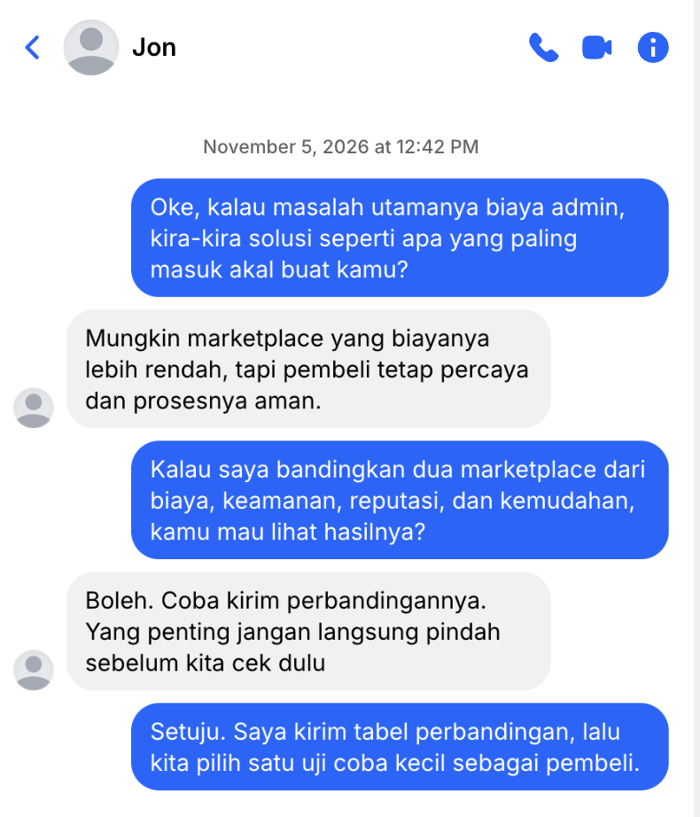

## Kompetensi target

Menghubungkan solution mechanism dengan problem, benefit, dan value yang relevan.

## Evidence wajib

- Attention evidence dan problem–solution link.
- Interest pitch dengan evidence atau demonstration.
- Response, state assessment, hidden concern, dan adaptation.

## Konteks performance

**Tanggal dan setting:** Discovery interview dilakukan pada 22 September 2026 selama sekitar 30 menit melalui percakapan daring. Pitch solusi dilakukan pada 5 November 2026 melalui Chat Facebook/Messenger.

**Objective dan initial state:** Objective saya adalah menghubungkan masalah biaya admin dengan kemungkinan alternatif marketplace tanpa langsung meminta Jon berpindah platform. Initial state Jon adalah Problem aware karena ia telah mengakui dampak biaya admin terhadap profit dan harga jual.

## Attention evidence dan solution hypothesis

**Attention evidence:** Jon menyatakan biaya admin marketplace dapat mencapai sekitar 20%, memberi contoh harga Rp200.000 menjadi Rp240.000, dan mengonfirmasi problem statement. Evidence ini menjadi dasar untuk membahas kemungkinan solusi.

**Solution hypothesis:** Membandingkan marketplace alternatif dari sisi biaya, keamanan, reputasi, dan kemudahan dapat membantu menemukan pilihan yang menjaga profit penjual tanpa mengurangi kepercayaan pembeli.

| Problem | Mechanism | Expected benefit | Value bagi target |
|---|---|---|---|
| Biaya admin tinggi mengurangi profit dan menaikkan harga | Membandingkan atau menguji perantara dengan biaya lebih rendah | Harga tidak perlu dinaikkan sebesar biaya marketplace | Profit Jon dan ketertarikan pembeli dapat lebih terjaga |
| Kekhawatiran keamanan dan kepercayaan | Memeriksa reputasi, keamanan, dan kemudahan proses sebelum berpindah | Risiko transaksi dapat dipahami sebelum digunakan | Jon tidak menukar profit dengan risiko kepercayaan |

## Pitch dan demonstration

> “Jon, berdasarkan masalah biaya admin tadi, saya ingin membandingkan beberapa pilihan marketplace dari sisi biaya, keamanan, kepercayaan, dan kemudahan. Tujuannya bukan langsung pindah platform, tetapi melihat apakah ada alternatif yang bisa menjaga profit tanpa membuat pembeli merasa tidak aman. Menurutmu, perbandingan seperti ini berguna untuk dipertimbangkan?”

**Response target:** Jon menjawab, “Nah bagus tuh kalo ada marketplace alternatif.” Ia kemudian bertanya, “itu fitur nya gimana aja? sama keuntungannya apa pake marketplace itu?”

## Hidden concern dan adaptation

**Asumsi awal tentang concern target:** Saya semula mengira concern utama Jon adalah biaya admin yang sangat besar.

**Hidden concern yang ditemukan:** Jon juga mempertimbangkan keamanan dan reputasi marketplace di mata pembeli. Hal ini terlihat dari pertanyaannya tentang fitur dan keuntungan marketplace alternatif setelah pitch solusi.

**Adaptation:** Awalnya saya menawarkan perbandingan biaya marketplace. Setelah Jon menyampaikan perhatian terhadap fitur dan keuntungan marketplace alternatif, saya mengubah fokus menjadi perbandingan biaya sekaligus reputasi, keamanan transaksi, dan kemudahan pembeli.

**State setelah interaksi:** State Jon menjadi **Interest** karena ia menyambut kemungkinan marketplace alternatif dan meminta informasi tentang fitur serta keuntungannya.

## Evidence

::: {.evidence-block}
**Transcript pitch solusi Messenger, 5 November 2026:**

> **Saya:** “Jon, berdasarkan masalah biaya admin tadi, saya ingin membandingkan beberapa pilihan marketplace dari sisi biaya, keamanan, kepercayaan, dan kemudahan. Tujuannya bukan langsung pindah platform, tetapi melihat apakah ada alternatif yang bisa menjaga profit tanpa membuat pembeli merasa tidak aman. Menurutmu, perbandingan seperti ini berguna untuk dipertimbangkan?”
>
> **Jon:** “Nah bagus tuh kalo ada marketplace alternatif. Itu fitur nya gimana aja? Sama keuntungannya apa pake marketplace itu?”

Transcript discovery dan konfirmasi problem statement dari Week 5 mendukung attention evidence. Langkah eksplorasi marketplace alternatif menjadi action setelah percakapan ini.
:::

**Evidence lanjutan:** Screenshot menunjukkan Jon menyetujui pengiriman perbandingan dan ikut menilai hasil uji coba kecil. Signal tersebut mendukung state **Interest**, bukan sekadar pengakuan masalah.

## Analisis komunikasi

| Elemen | Evidence dan analisis |
|---|---|
| Person & character | Jon adalah penjual diecast yang mempertimbangkan profit, harga wajar, keamanan, reputasi, dan kemudahan pembeli. Saya berperan sebagai partner yang membantu mengeksplorasi alternatif marketplace. |
| Objective & state | Objective saya adalah menguji apakah perbandingan marketplace relevan bagi Jon. State Jon berubah dari Problem aware menjadi Interest setelah menyambut alternatif dan meminta informasi fitur serta keuntungan. |
| Repertoire & language | Saya menggunakan evidence biaya, tujuan yang tidak memaksa perpindahan platform, serta bahasa yang menghubungkan biaya dengan keamanan dan kepercayaan pembeli. |
| Response & adaptation | Pertanyaan Jon tentang fitur dan keuntungan menunjukkan bahwa ia tidak hanya mempertimbangkan biaya. Saya mengadaptasi fokus solusi pada biaya, reputasi, keamanan, dan kemudahan. |
| Agreement/action | Jon menyetujui langkah awal untuk mengeksplorasi marketplace alternatif. |
| Relationship outcome | Jon merespons positif dan menunjukkan keterbukaan untuk membahas alternatif marketplace lebih lanjut. |

## Penggunaan AI

AI digunakan untuk membantu merapikan struktur portfolio dan menghubungkan evidence dengan rubrik. Isi percakapan, respons Jon, dan keputusan action berasal dari percakapan Messenger yang ditampilkan pada screenshot; AI tidak membuat atau mengubah respons Jon.

## Feedback dan tindak lanjut

**Feedback yang diterima:** Jon menyambut kemungkinan marketplace alternatif dan menanyakan fitur serta keuntungannya.  
**Adaptation/replay:** Fokus solusi diperluas dari biaya admin menjadi perbandingan biaya, reputasi, keamanan transaksi, dan kemudahan pembeli.  
**Next practice:** Mengeksplorasi marketplace alternatif berdasarkan fitur, biaya, keuntungan, keamanan, reputasi, dan kemudahan penggunaannya.

## Self-assessment

| Dimensi | Skor 1–4 | Evidence singkat |
|---|---:|---|
| Person & Character | 3 | Value dan concern Jon terhadap profit, keamanan, reputasi, dan kemudahan dipetakan. |
| Objective & State | 3 | Objective pitch jelas dan state Jon berubah menjadi Interest berdasarkan response langsung. |
| Repertoire, Language & AI | 3 | Pitch menggunakan evidence, bahasa tidak memaksa, dan menghubungkan problem dengan value. |
| Response & Adaptation | 4 | Pertanyaan Jon mengungkap concern keamanan dan reputasi, lalu fokus solusi diadaptasi. |
| Agreement, Action & Relationship | 3 | Jon merespons positif dan menyepakati eksplorasi marketplace alternatif. |

**Total:** 16 / 20

::: {.assessor-only}
### Assessment dosen

**Skor:** — / 20  
**Evidence yang mendukung:** —  
**Prioritas perbaikan:** —  
**Keputusan:** Belum dinilai / Perlu revisi / Tercapai
:::
