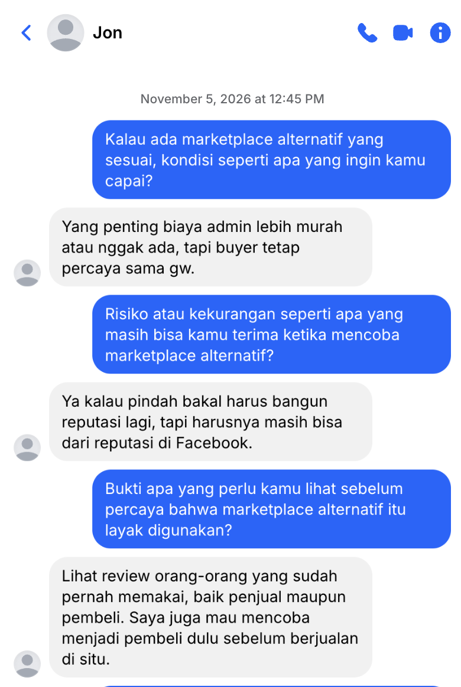
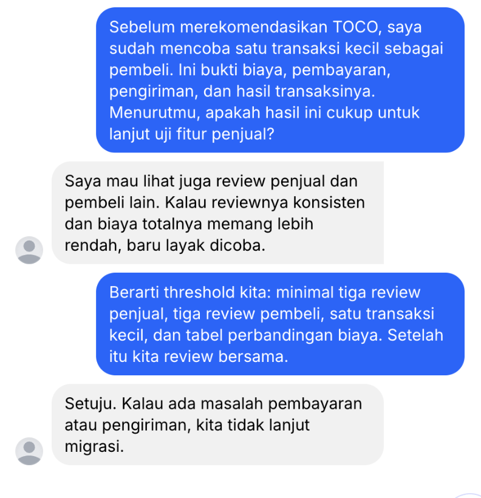

## Kompetensi target

Membangun desired state bersama target dan menghubungkannya dengan solution secara kredibel.

## Evidence wajib

- Current dan desired state milik person.
- Feature–benefit–value–outcome chain.
- Risk, evidence threshold, response, dan adaptation.

## Konteks performance

**Tanggal dan setting:** Discovery interview dilakukan pada 22 September 2026 selama sekitar 30 menit melalui percakapan daring. Percakapan lanjutan untuk menggali desired state dilakukan pada 5 November 2026 melalui Messenger.

**Person dan relationship:** Jon adalah teman dari Facebook dan penjual diecast. Ia menjadi partner discovery, bukan perwakilan semua penjual atau pembeli.

## Current dan desired state

| Elemen | Rumusan berdasarkan evidence, bukan asumsi |
|---|---|
| Current state | Jon menjelaskan biaya admin marketplace dapat mencapai sekitar 20%; contoh harga Rp200.000 perlu dinaikkan menjadi Rp240.000, sehingga profit tipis atau hanya balik modal dan calon pembeli dapat kurang tertarik. |
| Desired state | Biaya admin lebih murah atau tidak ada, tetapi pembeli tetap percaya kepada Jon sehingga profit penjual dan kepercayaan pembeli tetap terjaga. |
| Value | Menjaga profit Jon, mempertahankan kepercayaan pembeli, dan memungkinkan transaksi dengan biaya yang lebih rendah. |
| Acceptable risk | Jon bersedia membangun reputasi marketplace dari awal selama reputasi yang sudah dimiliki di Facebook tetap dapat membantu membangun kepercayaan pembeli. |
| Evidence threshold | Review dari penjual dan pembeli yang sudah menggunakan marketplace tersebut, serta pengalaman langsung sebagai pembeli sebelum Jon menggunakannya sebagai penjual. |

## Feature–benefit–value–outcome chain

`Perantara dengan biaya jasa yang lebih masuk akal dan proses aman` → harga tidak perlu dinaikkan terlalu tinggi → profit dan ketertarikan pembeli lebih terjaga → perlu diuji melalui perbandingan biaya, keamanan, kemudahan, dan hasil transaksi.

**Rumusan outcome:** Marketplace alternatif dinilai layak jika biaya lebih rendah, sistem pembayaran dan pengiriman dapat digunakan dengan baik, fitur serta antarmukanya mudah dipahami, dan reputasinya dapat dipercaya oleh penjual maupun pembeli.

## Percakapan dan response

> **Saya:** “Kalau ada marketplace alternatif yang sesuai, kondisi seperti apa yang ingin kamu capai?”  
> **Jon:** “Yang penting biaya admin lebih murah atau nggak ada, tapi buyer tetap percaya sama gw.”  
> **Saya:** “Risiko atau kekurangan seperti apa yang masih bisa kamu terima ketika mencoba marketplace alternatif?”  
> **Jon:** “Ya kalau pindah bakal harus bangun reputasi lagi, tapi harusnya masih bisa dari reputasi di Facebook.”  
> **Saya:** “Bukti apa yang perlu kamu lihat sebelum percaya bahwa marketplace alternatif itu layak digunakan?”  
> **Jon:** “Lihat review orang-orang yang sudah pernah memakai, baik penjual maupun pembeli. Saya juga mau mencoba menjadi pembeli dulu sebelum berjualan di situ.”

**Adaptasi solution atau objective:** Setelah Jon menjelaskan bahwa keamanan dan reputasi lebih penting daripada sekadar biaya rendah, saya mengubah fokus dari mencari marketplace termurah menjadi mencari marketplace yang seimbang dalam biaya, keamanan, reputasi, dan kemudahan.

## Risk dan evidence

**Risiko utama:** Jon perlu membangun reputasi kembali pada marketplace baru, dan pembeli belum tentu langsung percaya terhadap akun atau platform tersebut.

**Safeguard:** Marketplace alternatif tidak langsung digunakan untuk transaksi besar. Evaluasi dimulai dari perbandingan biaya, reputasi, fitur, sistem pembayaran, sistem pengiriman, dan antarmuka, kemudian dilanjutkan dengan uji coba terbatas sebagai pembeli.

**Evidence yang dibutuhkan:** Review dari penjual dan pembeli, hasil pengalaman Jon sebagai pembeli, perbandingan sistem pembayaran dan pengiriman, daftar fitur, serta catatan kemudahan penggunaan antarmuka.

**Status evidence:** Threshold telah dikonfirmasi dalam percakapan: tiga review penjual, tiga review pembeli, satu transaksi kecil sebagai pembeli, dan tabel perbandingan biaya. Stop rule yang disepakati adalah tidak melanjutkan migrasi apabila terdapat masalah pembayaran atau pengiriman.

## Evidence

::: {.evidence-block}
**Transcript desired-state Messenger, 5 November 2026:**

> **Saya:** “Kalau ada marketplace alternatif yang sesuai, kondisi seperti apa yang ingin kamu capai?”
>
> **Jon:** “Yang penting biaya admin lebih murah atau nggak ada, tapi buyer tetap percaya sama gw.”
>
> **Saya:** “Risiko atau kekurangan seperti apa yang masih bisa kamu terima ketika mencoba marketplace alternatif?”
>
> **Jon:** “Ya kalau pindah bakal harus bangun reputasi lagi, tapi harusnya masih bisa dari reputasi di Facebook.”
>
> **Saya:** “Bukti apa yang perlu kamu lihat sebelum percaya bahwa marketplace alternatif itu layak digunakan?”
>
> **Jon:** “Lihat review orang-orang yang sudah pernah memakai, baik penjual maupun pembeli. Saya juga mau mencoba menjadi pembeli dulu sebelum berjualan di situ.”

Transcript discovery, consent, dan konfirmasi problem statement dari Week 5 menjadi evidence pendukung. Bukti transaksi kecil dan persetujuan threshold pada screenshot mengubah rencana eksplorasi menjadi action yang terverifikasi.

:::

## Analisis komunikasi

| Elemen | Evidence dan analisis |
|---|---|
| Person & character | Jon adalah penjual yang ingin menurunkan biaya admin tanpa kehilangan kepercayaan pembeli. Ia bersedia mempertimbangkan pembangunan reputasi baru dengan dukungan reputasi Facebook. |
| Objective & state | Current state berupa biaya admin tinggi dan profit tipis. Desired state dirumuskan bersama sebagai biaya lebih rendah dengan kepercayaan pembeli tetap terjaga. |
| Repertoire & language | Saya menggunakan pertanyaan terbuka untuk menggali kondisi ideal, risiko yang dapat diterima, dan bukti yang dibutuhkan sebelum mengambil keputusan. |
| Response & adaptation | Jawaban Jon mengubah fokus dari biaya termurah menjadi keseimbangan biaya, reputasi, keamanan, fitur, dan kemudahan. |
| Agreement/action | Jon akan mengeksplorasi marketplace alternatif sebagai pembeli, membandingkan sistem pembayaran dan pengiriman, serta memeriksa fitur dan antarmukanya. |
| Relationship outcome | Jon terbuka menjelaskan kebutuhan, risiko, dan standar bukti yang ia perlukan sebelum mencoba marketplace alternatif. |

## Penggunaan AI

AI digunakan untuk menata hasil interview. Saya memeriksa ulang angka, batas evidence, dan nama samaran. AI tidak digunakan untuk menetapkan desired state atau threshold yang belum dikonfirmasi Jon.

## Feedback dan tindak lanjut

**Feedback yang diterima:** Jon menginginkan biaya admin yang lebih murah atau tidak ada, dengan kepercayaan pembeli tetap terjaga. Ia menerima kemungkinan membangun reputasi baru melalui reputasi Facebook dan membutuhkan review pengguna serta pengalaman sebagai pembeli sebelum berjualan.
**Adaptation/replay:** Saya mengubah fokus dari marketplace dengan biaya paling rendah menjadi marketplace yang seimbang dalam biaya, keamanan, reputasi, fitur, dan kemudahan.
**Next practice:** Mengeksplorasi fitur, antarmuka, sistem pembayaran, dan sistem pengiriman marketplace alternatif dengan memulai sebagai pembeli.

## Self-assessment

| Dimensi | Skor 1–4 | Evidence singkat |
|---|---:|---|
| Person & Character | 4 | Value, constraint, acceptable risk, dan kebutuhan evidence Jon dirumuskan dengan jelas. |
| Objective & State | 4 | Current state dan desired state dikonfirmasi melalui percakapan langsung. |
| Repertoire, Language & AI | 3 | Pertanyaan terbuka, value language, chain, dan penggunaan AI dijelaskan. |
| Response & Adaptation | 4 | Jawaban Jon mengubah fokus solusi dari biaya rendah menjadi keseimbangan beberapa value. |
| Agreement, Action & Relationship | 4 | Threshold, bukti transaksi kecil, review, tabel perbandingan, dan stop rule disepakati secara eksplisit. |

**Total:** 19 / 20

::: {.assessor-only}
### Assessment dosen

**Skor:** — / 20  
**Evidence yang mendukung:** —  
**Prioritas perbaikan:** —  
**Keputusan:** Belum dinilai / Perlu revisi / Tercapai
:::
