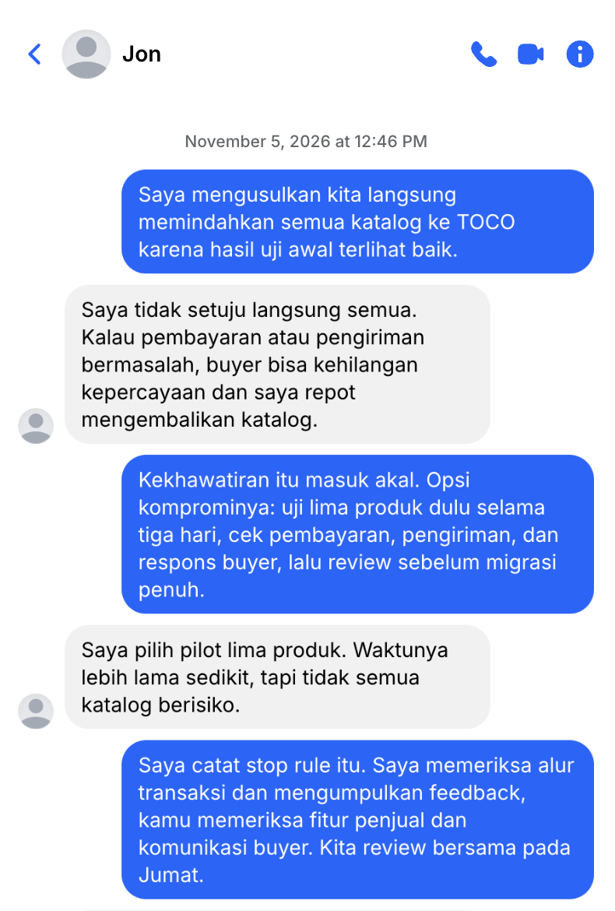

## Kompetensi target

Menemukan desire–action gap dan menghasilkan agreement yang feasible serta eksplisit.

## Evidence wajib

- Barrier dan authority map.
- Options dan trade-off yang dibahas.
- Agreement dengan owner/deadline serta bukti action atau review.

## Konteks performance

**Tanggal dan setting:** Setelah percakapan Week 9 pada 5 November 2026, saya dan Jon melanjutkan diskusi melalui Messenger untuk menguji kelayakan marketplace TOCO sebagai alternatif marketplace lama.

**Person dan relationship:** Jon adalah teman dari Facebook dan penjual diecast. Saya dan Jon memiliki authority untuk membuat akun, menguji fitur, mencoba pengalaman sebagai pembeli, dan menilai kelayakan TOCO berdasarkan hasil eksplorasi. Kami tidak memiliki authority untuk mengubah kebijakan TOCO.

**Desire dan initial state:** Desire Jon adalah menggunakan marketplace dengan biaya admin lebih murah atau tidak ada, tanpa kehilangan kepercayaan pembeli. Initial state: TOCO masih merupakan alternatif yang perlu diuji dari sisi fitur, UI, pembayaran, pengiriman, dan fitur penjual.

## Desire–action gap

Desire–action gap berada pada jarak antara keinginan menggunakan marketplace dengan biaya admin lebih rendah dan kebutuhan untuk memastikan bahwa marketplace tersebut benar-benar mudah, aman, responsif, dan dapat digunakan untuk aktivitas penjual.

| Barrier | Person dengan authority | Respons atau langkah yang dibutuhkan |
|---|---|---|
| Kelayakan fitur dan UI TOCO belum diketahui | Saya dan Jon dapat menguji fitur sebagai pengguna | Membuat akun, mencari produk, dan memeriksa tampilan serta respons sistem |
| Sistem pembayaran dan pengiriman perlu dibandingkan | Saya dan Jon dapat mencoba alur pemesanan sebagai pembeli | Melakukan pemesanan dan mencatat opsi pembayaran serta pengiriman |
| Kemudahan membuka toko dan mengelola penjualan perlu diverifikasi | Jon memiliki pengalaman sebagai penjual dan dapat menguji fitur penjual | Membuka atau mengeksplorasi halaman penjual serta memeriksa aktivitas yang dapat dipantau |

**Kesalahan pemetaan authority yang diperbaiki:** Jon tidak dianggap sebagai pihak yang dapat mengubah kebijakan TOCO. Authority Jon dan saya dibatasi pada pengujian pengalaman pengguna dan penilaian kelayakan berdasarkan fitur yang tersedia.

## Options dan trade-off

1. **Membandingkan informasi marketplace:** memberikan gambaran awal tentang biaya dan reputasi, tetapi tidak menguji pengalaman penggunaan.  
2. **Menguji TOCO sebagai pembeli:** dapat menguji pencarian, pemesanan, pembayaran, pengiriman, respons sistem, dan UI secara langsung.  
3. **Menguji fitur penjual TOCO:** dapat menunjukkan kemudahan membuka toko dan memantau aktivitas penjualan, tetapi belum mencakup migrasi stok dan katalog.

**Opsi yang dipilih:** Menguji TOCO secara langsung sebagai pembeli dan penjual sebelum memindahkan stok serta katalog dari marketplace lama.
**Syarat atau batasan:** Migrasi stok dan katalog dilakukan setelah fitur, UI, sistem pembayaran, sistem pengiriman, reputasi, dan fitur penjual dinilai layak.

## Agreement eksplisit

> **Scope:** Membuat akun, mencari produk, mencoba pemesanan, memeriksa pembayaran dan pengiriman, serta mengeksplorasi fitur penjual dan UI TOCO. Migrasi stok dan katalog belum termasuk dalam pengujian awal.  
> **Owner:** Saya dan Jon melakukan pengujian serta menilai hasilnya bersama. Jon memberikan perspektif sebagai penjual, sedangkan saya ikut memeriksa pengalaman pengguna dan alur transaksi.  
> **Deadline:** Evaluasi dilakukan sebelum keputusan pemindahan stok dan katalog dari marketplace lama.  
> **Evidence:** Hasil pembuatan akun, pencarian produk, pemesanan, pilihan pembayaran dan pengiriman, fitur penjual, UI, serta catatan evaluasi bersama.  
> **Stop rule:** Migrasi tidak dilakukan apabila fitur utama, sistem pembayaran, sistem pengiriman, keamanan, reputasi, atau kemudahan penggunaan tidak memenuhi kebutuhan penjual dan pembeli.  
> **Review:** Hasil pengujian ditinjau bersama setelah seluruh fitur utama diperiksa.

## Action evidence dan adaptation

**Action yang benar-benar terjadi:** Saya dan Jon membuat akun TOCO, mencari produk, dan menemukan bahwa hasil pencarian relevan dengan kata kunci yang dimasukkan. Kami mencoba memesan satu barang dan menemukan bahwa prosesnya responsif serta menyediakan banyak pilihan pembayaran dan pengiriman. Kami juga mengeksplorasi fitur penjual dan menemukan bahwa pembukaan toko mudah, tidak memerlukan data yang rumit, serta menyediakan UI yang rapi untuk memantau aktivitas penjualan. Percakapan lanjutan memperlihatkan negosiasi antara kebutuhan segera mengurangi biaya admin dan kebutuhan menguji fitur secara lengkap.

**Adaptation:** Setelah pengujian menunjukkan bahwa TOCO mudah digunakan sebagai pembeli dan penjual, fokus action berubah dari sekadar membandingkan marketplace menjadi menyiapkan kemungkinan migrasi stok dan katalog dari marketplace lama.

## Evidence

::: {.evidence-block}
**Paraphrase percakapan Messenger tentang action dan agreement:**

> **Saya dan Jon:** Kami menyepakati untuk menguji TOCO sebagai pembeli dan penjual sebelum memindahkan stok serta katalog dari marketplace lama. Pengujian mencakup pembuatan akun, pencarian produk, pemesanan, pilihan pembayaran, pilihan pengiriman, fitur penjual, dan UI.

**Hasil action:** Akun berhasil dibuat dengan proses yang mudah. Pencarian menghasilkan barang yang relevan dengan kata kunci. Pemesanan berjalan responsif dengan banyak pilihan pembayaran dan pengiriman. Fitur penjual mudah digunakan, tidak memerlukan data yang rumit, dan memiliki UI yang rapi untuk memantau aktivitas penjualan.

**Evidence pendukung:** Catatan percakapan Messenger, catatan hasil pengujian, dan catatan rencana migrasi stok serta katalog.
:::

**Hasil negosiasi:** Jon memilih pilot lima produk selama tiga hari sebagai kompromi antara kecepatan mengurangi biaya admin dan risiko fitur yang belum lengkap. Saya bertanggung jawab memeriksa pembayaran/pengiriman, Jon memeriksa fitur penjual/data katalog, dan review dijadwalkan pada Jumat. Migrasi penuh hanya dilakukan apabila hasil pilot tidak menunjukkan masalah.

## Analisis komunikasi

| Elemen | Evidence dan analisis |
|---|---|
| Person & character | Jon berperan sebagai penjual yang menilai kemudahan fitur penjual, sedangkan saya ikut menguji pengalaman pengguna dan alur transaksi. |
| Objective & state | Desire untuk marketplace yang lebih murah dan tetap dipercaya diubah menjadi action pengujian TOCO. Hasil pengujian menunjukkan TOCO layak dipertimbangkan sebagai alternatif. |
| Repertoire & language | Kami menggunakan diskusi berbasis kriteria, pengujian langsung, perbandingan pengalaman, dan evaluasi fitur sebelum mengambil keputusan migrasi. |
| Response & adaptation | Respons positif terhadap fitur pencarian, pemesanan, pembayaran, pengiriman, dan halaman penjual mengubah fokus dari evaluasi awal menjadi persiapan migrasi katalog dan stok. |
| Agreement/action | Scope, pembagian pengujian, evidence, batas migrasi, dan review dirumuskan berdasarkan evaluasi bersama. |
| Relationship outcome | Kerja sama dengan Jon menghasilkan penilaian bersama bahwa TOCO layak dipakai sebagai alternatif marketplace dengan biaya admin besar. |

## Penggunaan AI

AI digunakan untuk membantu menata hasil pengujian ke dalam struktur portfolio. Fakta tentang fitur, UI, pembayaran, pengiriman, fitur penjual, dan rencana migrasi berasal dari pengujian bersama saya dan Jon. Saya memeriksa kembali kesesuaian isi dengan pengalaman yang dilakukan.

## Feedback dan tindak lanjut

**Feedback yang diterima:** Jon dan saya menilai TOCO memiliki proses pembuatan akun yang mudah, pencarian produk yang relevan, pemesanan yang responsif, banyak pilihan pembayaran dan pengiriman, serta fitur penjual yang rapi dan mudah digunakan. Reputasi TOCO juga dinilai baik karena telah digunakan oleh lebih dari 200.000 penjual.
**Adaptation/replay:** Setelah TOCO dinilai layak sebagai alternatif, fokus berikutnya diarahkan pada persiapan migrasi stok dan katalog dari marketplace lama.
**Next practice:** Menyusun proses migrasi stok dan katalog secara bertahap dengan memeriksa kesesuaian data, format katalog, dan kesiapan fitur penjual TOCO.

## Self-assessment

| Dimensi | Skor 1–4 | Evidence singkat |
|---|---:|---|
| Person & Character | 4 | Peran Jon sebagai penjual dan peran saya sebagai partner pengujian dibedakan. |
| Objective & State | 4 | Desire–action gap diubah menjadi pengujian langsung yang menghasilkan penilaian kelayakan TOCO. |
| Repertoire, Language & AI | 3 | Kriteria, pengujian fitur, evaluasi UI, dan penggunaan AI dijelaskan. |
| Response & Adaptation | 4 | Hasil pengujian mengubah fokus dari evaluasi marketplace menjadi persiapan migrasi. |
| Agreement, Action & Relationship | 3 | Scope dan action pengujian terlaksana, sedangkan migrasi menjadi langkah lanjutan. |

**Total:** 18 / 20

::: {.assessor-only}
### Assessment dosen

**Skor:** — / 20  
**Evidence yang mendukung:** —  
**Prioritas perbaikan:** —  
**Keputusan:** Belum dinilai / Perlu revisi / Tercapai
:::
